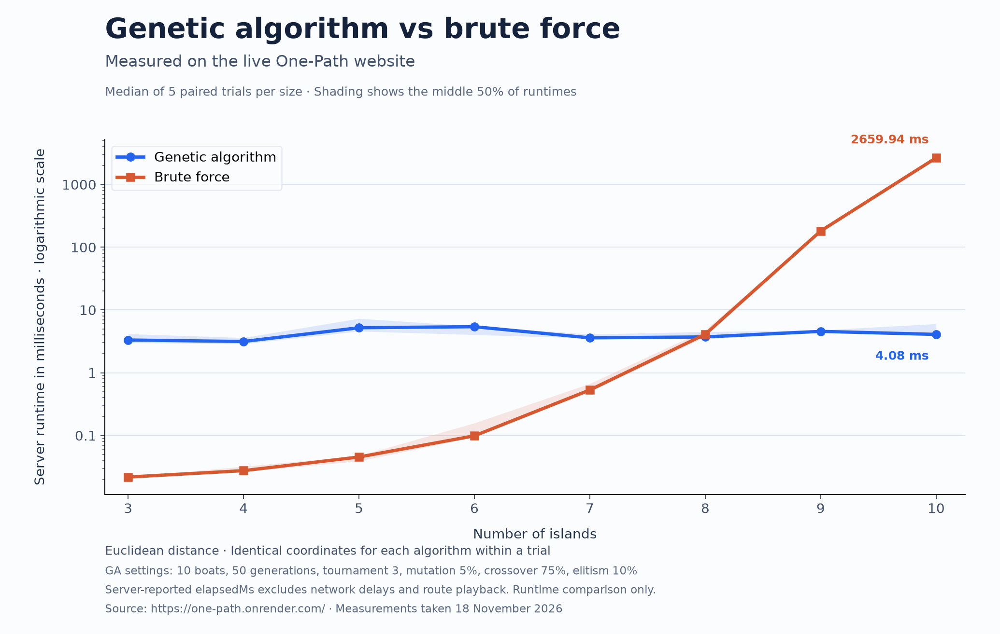

# One-Path
An interactive web visualiser that compares a genetic algorithm against a brute-force method on the shortest closed tour through a set of islands, solving the traveling salesman problem.

- **Live site:** https://one-path.onrender.com/

---
## 1. Selected algorithm
The main algorithm we are using is a genetic algorithm with tournament selection, ordered crossover, swap mutation and elitism. We are measuring this against a brute-force exhaustive search.

## 2. Problem
One-Path solves the **Travelling Salesman Problem (TSP)**. Given **n** islands placed on a 50 × 30 grid, find the shortest route that visits every island exactly once and returns to the starting island.

- A route is represented as a string of island IDs, e.g. `"ACBDE"`. The return leg from the last island back to the first is included in the distance.

- Distance can be measured with the Manhattan, Euclidean or Chebyshev metric.

- TSP is NP-hard; the number of candidate tours for this exhaustive-search approach grows factorially, so exact search quickly becomes impractical. A genetic algorithm trades a guarantee of optimality for a fast, usually near-optimal answer.

## 3. Intended users
- Students learning about the TSP, heuristics and genetic algorithms.

- Educators who want to demonstrate visually how GA parameters (population, mutation, crossover, elitism, tournament size) affect convergence.

- Anyone who wants to see the gap between exact and heuristic search as the number of islands grows.

---
## 4. Installation, access and testing
### Running locally
#### Install and setup
Make sure you are using Python 3.13, then run:

```sh

git clone https://github.com/ColumXB/One-Path.git

cd One-Path

# macOS / Linux

python3 -m venv .venv

source .venv/bin/activate

# Windows (PowerShell)

py -3 -m venv .venv

.\.venv\Scripts\Activate.ps1

python -m pip install -r requirements.txt

python manage.py migrate

```

#### Run and access
```sh

python manage.py runserver

```

Open <http://127.0.0.1:8000/> in a browser 

1. Adjust settings such as island count to your liking

2. Pick a fitness function to measure distance

3. Press **Run** and watch the algorithm evolve!

4. Toggle **Brute Force** to watch an exhaustive search through candidate tours

5. See the execution time differences or scroll down and see how the two algorithms performed 

#### Run the tests
```sh

# Activate the virtual environment first if it is not already active.

python manage.py test

```

The command discovers tests under `test_app/tests/`, creates an isolated Django test database, and exits non-zero if any test fails. On Windows, use:

```powershell

.venv\Scripts\python.exe manage.py test

```

To run one test group while diagnosing a failure:

```sh

python manage.py test test_app.tests.test_genetic_algorithm

python manage.py test test_app.tests.test_brute_force

python manage.py test test_app.tests.test_endpoints

python manage.py test test_app.tests.test_cancellation

python manage.py test test_app.tests.test_admin

```

### Alternatively
 Follow the link below to see the deployed version of the application, note it may take a few seconds to boot on the hosting service.

 - https://one-path.onrender.com/ 

### Interface parameters
| Parameter               | Range                           | Default |
| ----------------------- | ------------------------------- | ------- |
| Islands                 | 3 – 20 (3 – 12 for brute force) | 5       |
| Boats (population size) | 2 – 100                         | 10      |
| Tournament size         | 1 – population size             | 3       |
| Generations             | 1 – 500                         | 50      |
| Mutation rate           | 0 – 100 %                       | 5 %     |
| Crossover rate          | 0 – 100 %                       | 75 %    |
| Elitism                 | 0 – 100 %                       | 10 %    |
### Details about parameters

The application allows users to configure various parameters to control how the Travelling Salesperson Problem (TSP) is solved. These settings affect the problem's complexity, the genetic algorithm's behaviour, and the resulting routes.

#### General Settings

| Parameter | Description |
|---|---|
| **Brute Force** | Enables a brute-force solution that evaluates every possible route to find the shortest one. Useful for comparing the genetic algorithm against an optimal solution, although computation time increases rapidly with more islands. |
| **Brute Force Time** | Displays how long the brute-force algorithm takes to find its solution. |
| **Genetic Algorithm Time** | Displays how long the genetic algorithm takes to complete. |
| **Number of Islands** | Sets the number of islands the boats must visit. Increasing this makes the problem more complex as there are more possible routes. |
| **Ship Speed** | Controls how quickly boats travel between islands in the animation. It does not change route distances or algorithm runtime. |

#### Fitness Function

The fitness function determines how the quality of a route is evaluated. Users can select from three distance metrics:

| Parameter | Description |
|---|---|
| **Manhattan** | Calculates distance using horizontal and vertical movement, similar to travelling along a grid of streets. |
| **Euclidean** | Calculates the straight-line distance between two points. |
| **Chebyshev** | Calculates distance using the largest horizontal or vertical difference between two points. |

#### Genetic Algorithm Settings

The genetic algorithm uses an evolutionary approach to find efficient routes. It begins with a population of candidate routes and improves them over successive generations using selection, crossover, and mutation.

| Parameter | Description |
|---|---|
| **Number of Boats** | Sets the population size, representing how many candidate routes are evaluated in each generation. Larger populations increase route diversity but require more computation. |
| **Tournament Size** | Determines how many candidate routes compete during parent selection. The best route from each tournament is selected. Larger tournaments increase the preference for stronger solutions. |
| **Max Number of Generations** | Sets the maximum number of evolutionary cycles the algorithm can perform. More generations provide additional opportunities to improve routes but increase execution time. |
| **Mutation Rate** | Controls the probability of an island in a route undergoing a random swap. Mutation helps maintain diversity and prevents the algorithm from becoming stuck with similar solutions. |
| **Crossover Rate** | Controls the probability of combining two parent routes to produce offspring. Crossover allows useful characteristics from different routes to be combined while preserving valid island orderings. |
| **Elitism Count** | Sets the percentage of the best-performing routes copied unchanged into the next generation. The number copied is the population size multiplied by this rate, rounded down. This prevents strong solutions from being lost during crossover and mutation. |

#### How These Parameters Affect Performance

- **Larger populations** explore more possible routes but increase computation time.
- **Larger tournament sizes** favour stronger routes but may reduce population diversity.
- **More generations** allow additional optimisation but take longer to complete.
- **Higher mutation rates** encourage exploration but may disrupt effective routes.
- **Higher crossover rates** encourage combining existing solutions to discover potentially better routes.
- **Higher elitism percentages** preserve more successful routes but can reduce diversity and cause premature convergence.

Finding an effective balance between these parameters can improve the quality of the routes produced by the genetic algorithm.

---
## 5. Algorithm explanation
Let **n** = number of islands, **P** = population size ("boats"), **G** = number of generations, **k** = tournament size.

Shared set-up (`route_search.py`): all pairwise distances are computed once and cached, so scoring a tour is **n** table look-ups.

### 5.1 Genetic algorithm (`genetic_algorithm.py`)
```

population ← P random permutations of the islands

for generation in 1 … G:

    rank population by tour distance (shortest first)

    record best, median, worst, list of all

    if not last generation:

        next ← the top floor(P × elitism) tours          # elitism

        while len(next) < P:

            p1 ← best of k random tours                  # tournament selection

            p2 ← best of k random tours

            if random() < crossoverRate:

                c1, c2 ← ordered_crossover(p1, p2)       # preserve a slice and fill the rest from the other parent
            else:

                c1, c2 ← p1, p2                          # parent's order

            for each child:

                for each position i:                     # swap mutation

                    if random() < mutationRate: swap gene i with a random other gene

                add child to next

        population ← next

```

Every operator keeps each island exactly once, so every individual is always a valid tour.

### 5.2 Brute force (`brute_force.py`)
```

fix island A as the start                         # removes rotated duplicates

best ← ∞

for each permutation of the remaining n-1 islands:

    skip if first > last                          # removes mirror-image (reversed) tours

    d ← tour distance

    if d < best: best ← d; record the improvement

```

This evaluates (n−1)!/2 distinct tours and is guaranteed to return the optimal tour.

- 5 islands => 12 possible tours

- 8 islands => 2,520 possible tours

- 10 islands => 181,440 possible tours

- 12 islands => 19,958,400 possible tours

### 5.3 Complexity
**n**  =  the number of islands

**P** = the population size (the number of boats)

**G** = the number of generations

**k** = the tournament size.

**Brute force.** The search fixes island A as the start and generates every ordering of the other n−1 islands, which is (n−1)! permutations. It skips the ones whose first island comes after their last, because those are mirror images of tours already seen. That halves the work but not the growth rate. Each tour that survives is scored in O(n), since the return leg is included and every distance is a table look-up. The time complexity is therefore **O((n−1)! · n)**, which is factorial in the number of islands. This is why brute force is capped at 12 islands. The distance cache uses **O(n²)** space. Recording improvements also consumes memory (O(n) per saved tour), so total memory use additionally depends on how many improvements are retained.

**Genetic algorithm.** Each of the G generations scores all P tours in O(P · n), sorts them in O(P log P), and then breeds P children. Each child needs a tournament of k contestants, which costs O(k). Ordered crossover costs O(n²), because each gene has to be checked against the preserved slice of the other parent to avoid duplicate island visits. One mutation pass costs O(n). Summed over the generation, this gives a time complexity of **O(G · P · (n² + k + log P))**. For a fixed G and P, the running time is polynomial in n, not factorial. The space complexity is **O(n² + G · P · n)**. The distance table is O(n²), and the live population is only O(P · n). The implementation also stores the full ranked population of every generation so the front end can replay it, and that O(G · P · n) term dominates.

Notes on the genetic algorithm figures:

- Per generation: scoring is O(P·n), sorting is O(P log P), and breeding costs O(k) per selection plus O(n²) per crossover (membership check against the preserved slice) and O(n) per mutation pass, repeated P times.

- Space: the distance cache is O(n²); the live population is O(P·n). The implementation also stores the full ranked population for **every** generation so the front end can animate it, which is the dominant term, O(G·P·n).

- For a fixed budget (**G**, **P**) the genetic algorithm is **polynomial** in **n**, whereas brute force is **factorial**. That is why brute force is capped at 12 islands.

---
## 6. Test cases and results
### 6.1 Automated tests
36 tests in `test_app/tests/`, all run with `python manage.py test`.

| Group | What is checked |
|---|---|
| Admin page | Django admin login page responds (smoke test) |
| Shared validation | Island coordinates must match the island count and the fitness function must be one of Manhattan, Euclidean or Chebyshev |
| Genetic algorithm | Every generation has **P** valid tours (right length, each island once, non-negative distance); best ≤ median ≤ worst; closed-tour distance including the return leg for Manhattan (14), Euclidean (12) and Chebyshev (11) on a 3-4-5 triangle; symmetric distance cache with no self-legs |
| GA parameter validation | Population < 2 rejected; tournament size > population rejected; tournament size read from parameters |
| GA operators | Ordered crossover and swap mutation always return each island exactly once; tournament selection chooses the best sampled candidate, including when the whole population competes; elitism preserves top-ranked tours and handles 0 % and 100 %; crossover is disabled at 0 % and always runs at 100 %; mutation is evaluated per gene and can make several swaps in one pass, and a 100 % rate attempts every gene; a 0 % mutation rate leaves the tour unchanged; requested generation counts are respected; out-of-range generation lookups return `None` |
| Brute force | On a 4-island rectangle the recorded improvements are exactly ABCD = 18 → ABDC = 16 → ACBD = 14 (the known optimum); boat count is ignored and re-running resets progress; 13 islands rejected; 12 islands accepted |
| Cancellation | Cancelling before start is honoured and the solver can be run again; both solvers stop mid-search and keep the progress already recorded |
| HTTP endpoints | Malformed or missing payloads and mismatched island counts are rejected; partial progress is visible while a run is active; completed genetic and brute-force runs return generations and elapsed time; a crashed worker reports `failed` with no run time; cancel reports `cancelling` then `cancelled`; cancelling a finished run keeps its result; unknown run ID returns 404; GET on the cancel URL returns 405 |

**Verification evidence:** A full run with `python manage.py test` currently reports `Ran 36 tests … OK`. This is the repeatable pass/fail evidence for the implementation.

### 6.2 Genetic algorithm vs brute force: solution quality

An initial local comparison used Euclidean distance, random island positions on a 30 × 20 grid, and GA settings of 50 boats, 200 generations, 5% mutation, 75% crossover, 10% elitism, and tournament size 3. The GA was run 10 times on each map. Timings were measured on one development machine and are indicative rather than hardware-independent benchmarks.

| Islands | Brute-force time | Brute-force best distance | GA time (per run) | GA outcome |
| --- | ---: | ---: | ---: | ---: |
| 8 | ≈ 0.002 s | 68.31 | ≈ 0.03 s | 10/10 |
| 10 | ≈ 0.19 s | 73.13 | ≈ 0.04 s | 10/10 |
| 11 | ≈ 2.1 s | 81.52 | ≈ 0.04 s | 10/10 |
| 20 (GA only) | Not measured (exhaustive search impractical) | N/A | ≈ 0.3 s (100 boats, 500 generations) | Best recorded distance improved from 204.3 to 89.6 |

Across the three smaller instances, the genetic algorithm matched the brute-force optimum in all 10 runs per map. This provides evidence of good solution quality **on these specific instances**, but it does not establish that the GA always finds an optimum. For the 20-island instance, the best recorded route distance decreased substantially; because brute force was not run, its optimality gap is unknown. The 20-island trial also used different GA settings, so its runtime should not be interpreted as a controlled extension of the smaller-size results.

### 6.3 Live deployment runtime comparison

A second experiment measured **server-reported algorithm runtime** through the live One-Path website's endpoints on 18 November 2026. For each island count from 3 to 10, five paired trials used identical island coordinates for the GA and brute-force search: 8 sizes × 5 paired trials × 2 algorithms = **80 algorithm runs**. The plotted points are median runtimes and the shaded bands show the middle 50% of measurements. Network latency and front-end route animation were excluded.

The GA used the website defaults: **10 boats, 50 generations, tournament size 3, 5% mutation, 75% crossover, and 10% elitism**. Euclidean distance was used for both algorithms.



At 10 islands, median runtime was **4.08 ms for the GA**, versus **2,659.94 ms (approximately 2.66 s) for brute force**. The logarithmic y-axis makes the increase in brute-force runtime visible across several orders of magnitude. For these measured settings, brute force was faster on the smallest instances but became much slower as the island count increased. GA runtime remained comparatively stable within the tested 3–10-island range.

These are measurements from the deployed environment rather than universal runtime guarantees. Individual timings may vary with server load, random variation and instance layout. This live experiment uses **different GA settings and a different measurement environment** from the local experiment in Section 6.2, so their absolute runtimes should not be directly compared.

### 6.4 Population-size experiments

Two sets of observations explore how the number of boats (the GA population size) relates to runtime. The 10-island measurements report execution time only; the 20-island measurements additionally record the best tour distance, where **lower is better**.

**10-island runtime observations**

| Boats | Reported runtime |
| ---: | ---: |
| 10 | 4.217 ms |
| 25 | 10.185 ms |
| 50 | 87.861 ms |
| 100 | 268.634 ms |

**20-island runtime and solution-quality observations (three trials per population size)**

Each run records server execution time and its best tour distance (lower distance is better). The table shows the full raw observations, followed by descriptive statistics.

| Boats | Runtime: trials 1 / 2 / 3 (ms) | Best distance: trials 1 / 2 / 3 |
| ---: | --- | --- |
| 10 | 12.095 / 31.184 / 5.663 | 200.34 / 247.75 / 214.98 |
| 25 | 78.207 / 29.618 / 12.828 | 223.76 / 199.20 / 204.96 |
| 50 | 211.126 / 66.533 / 41.270 | 195.74 / 178.75 / 202.22 |
| 100 | 300.719 / 389.689 / 452.924 | 165.18 / 168.83 / 174.35 |

| Boats | Median runtime (ms) | Mean best distance | Sample standard deviation of best distance |
| ---: | ---: | ---: | ---: |
| 10 | 12.095 | 221.02 | 24.28 |
| 25 | 29.618 | 209.31 | 12.84 |
| 50 | 66.533 | 192.24 | 12.12 |
| 100 | 389.689 | **169.45** | 4.62 |


Across these observations, higher population sizes were associated with increased median runtime and shorter **mean** best-tour distances. The 100-boat configuration produced an average best-tour distance approximately 23.3% shorter than the 10-boat configuration, while its median execution time was approximately 32 times as long. Individual results were not strictly monotonic (for example, the first 25-boat trial gave a longer route than the first 10-boat trial). The 100-boat distances also varied less across these three runs, but the sample is too small to establish a reliable statistical trend.

These results provide exploratory evidence of a runtime–solution-quality trade-off. It has not yet been confirmed whether all trials used **identical island coordinates** and **the same remaining GA settings**. If these differed, the quality differences cannot be attributed confidently to population size alone. The three trials per population are not sufficient for a strong statistical conclusion; additional paired runs would improve reliability. The 10-island and 20-island experiments should not be compared directly because their problem sizes differ.

### 6.5 Evaluation limitations

- The local solution-quality comparison covers only three small maps with known optima; successful runs do not imply a guarantee of optimality on other instances.
- The deployed runtime comparison uses five trials per island count. Reporting distributions helps, but more trials and repeated conditions would increase confidence.
- The 20-island population-size experiment has three recorded trials per setting, but identical island layouts and fixed non-population GA settings have not yet been confirmed. Three trials offer limited precision and the comparison cannot isolate the effect of population size unless the remaining conditions are controlled.
- Runtime comparisons are specific to the hardware, hosting conditions, GA settings and island layouts used. The local and deployed experiments are not directly interchangeable.

---
## 7. Known limitations, dependencies and third-party resources
### Known limitations
- **Brute force is capped at 12 islands**; beyond that the factorial run time is impractical. The island slider goes to 20 for the genetic algorithm only.

- The genetic algorithm is a **heuristic**: it does not guarantee the optimal tour, and results vary run to run (it is not seeded).

- **Run state is held in server memory** (a Python dictionary guarded by a lock). Runs are lost on restart, are never cleaned up, and are not shared between multiple gunicorn workers.

- Runs execute on **background threads** inside the web process, with no queue or limit on concurrent runs, so heavy use could slow the server.

- The server stores every individual of every generation, so memory use grows with **G** × **P** × **n**.

- Cancellation is cooperative: it takes effect at the next check, not instantly.

- Only symmetric distance metrics on a grid of whole cells are supported; there are no obstacles, real-world distances or fixed start points.

- Island IDs are the letters A–T, which is what limits the map to 20 islands.

- The Django database is unused apart from the built-in admin and auth tables.

- Hosted on a free Render plan, so the live site may be slow to wake up.

### Dependencies (`requirements.txt`)
| Package | Version | Purpose |
|---|---|---|
| Django | 6.1.2 | Web framework, routing, tests |
| asgiref | 3.13.0 | Django dependency |
| sqlparse | 0.6.0 | Django dependency |
| tzdata | 2026.5 | Time zone data |
| gunicorn | 23.0.0 | Production WSGI server |
| whitenoise | 6.9.0 | Serves static files in production |

The algorithms themselves use only the Python standard library (`random`, `itertools`, `math`, `threading`). The front end is plain HTML, CSS and JavaScript with no external libraries.

### Licence
MIT. See `LICENSE`.

---
## 8. Team contributions
| Member         | Contributions                             |
| -------------- | ----------------------------------------- |
| Finn Gosney    | Hosting, deployment, pr reviews           |
| Colum Bailey   | Genetic algorithm implementation, pr reviews          |
| Matthew Dawson | Front end side panel, brute force algorithm |
| Jacob Nixon    | Front end algorithm display, Front end side panel                        |
| Kadeem Hannan  | Presentation, artwork                    |
| Finlay Fordham | Front end algorithm display, pr reviews                        |

## 9. Acknowledgement of generative AI use
### How Generative AI Was Handled
1. Each prompts output was reviewed by the individual generating it

2. Tests were generated and then checked by the individual

3. Results of implementation were also checked manually locally and when hosted

4. All of the above was reviewed by two different peers in each pull request for each feature on a designated branch

### Generative AI Prompt History
This section records the generative AI prompts supplied by group members during development. Prompts are organised by contributor and tool/model, in the order provided. Original wording (including spelling) has been retained where possible; only line wrapping and Markdown formatting have been adjusted. This is a prompt history, not a record of AI responses or a claim that every suggestion was implemented.

#### Colum Bailey
##### Claude Sonnet 5.5 — Django project setup
1. I need to start up a new django project where do I start?

2. I have a repo setup with a gitignore and readme in there thanks to a github default, does that change anything with the venv setup?

3. what python version should I be running?

4. I've just run python manage.py createsuperuser and it's asked for a username and email address, do I have to give an actual email address?

##### Claude Sonnet 5.5 — Genetic algorithm planning and general questions
1. Hey Claude, i've got to implement a genetic algorithm to solve the travelling salesman problem. This is being done in the backend of a python django project. my current design would take in population size, number of nodes, node coordinates, mutation rate, crossover rate, and elitism percentage. It would then either send out one generation at a time and then at the end of generation send a full history so the user on the frontend can explore previous generations. Each generation should contain each individuals route through TSP along with a highlighted best, median, and worst solution in both the generation by generation outputs and the full generational history.

   However i think this would require a good amount of testing on my end to check everything is working in coding and I have a large time constraint which requires inputs and outputs to be functional for the start of the week but only requires the full functionaliy at the end of the week. Do you think I should create a wiremock like input output processor so others can progress or should I do the full implementation

2. Side question with django, do static and staticfiles folders do something different?

3. What is the difference between tournament selection and fitness-proportionate/roulette selection? Please explain both concepts too

4. How do you check what branch you're currently on

##### VS Code Copilot — GPT 6 Luna
1. Hi Copilot, hope you're doing well! I've created an input output template here for a genetic algorithm and it's time to put the genetic algorithm to solve the TSP problem. So let's start by planning and then we can move to implementation. My idea currently is to have each solution's representation be "ABCDE" so the salesperson in TSP or boat in our case would from from city/island A to B to C to D to E and then back to A.

   I was also thinking of using swap mutation is the primary mutation method and ordered crossover as the crossover method. Implementation wise currently my plan is to run() start the evolution process where it can initialise the population and start evolving it generation by generation. Then get_generation() can be run to query a set generation so that a frontend can be run to display each display as the actual evolution happens in the background. I've likely missed something in this plan so please do ask questions. Once we agree upon a plan then I can start coding

2. Can you pull tournament size in as parameter like the other parameters such as num_nodes, pop_size etc.

3. Should the pop_size variable have a minimum size equal to tournament size? Also what should tournament's minimum size be?

4. Lets raise the minimum to two inside the genetic algorithm file and write a todo in the file to update this minimum elsewhere

5. Shuold max tournament size be set to population size then?

6. so we don't need to set this to population size?

7. As this calciulation will be run frequently, would it be efficient to store it in a dictionary of sorts?

8. In a distance total of the solution ABC. Would this add the distances A->B, B->C, C->A?

9. Could this be calculated once in the initialisation phase? If you agree it should be, please implement it

10. is mutation rate meant to be applied to each element in a solution for mutation, or just once? I think being able to have multiple mutations in a solution could be cool

11. Could you implement that please

12. Can you outline what it would look like if we were checking per element in the solution for mutation. I think it would make more sense as it would scale with the mutatio nrate

13. Actually, do you remember how to didn't push the pop-size and tournament size restrictions up to the front end. Could we do that now?

14. Does this cover all the changes we made today concisely?

    - Replaced genetic algorithm placeholder with full genetic algorithm using a tournament based comparison, ordered crossover, and swap mutation. Swap mutation is applied to each element in each solution.

    - Tournament size was added as a parameter to the frontend as it is now required, it is limited at the maximum end by population size

    - Tournament size's minimum is set to 2 and population's has been changed to 3

    - A frontend integration was made with the genetic algorithm for testing but it will NEED changing to fit the required spec

15. Would it be more effective to use ENUMs here? Or would keeping the strings be better as they're pulled from a http request

16. Is it best practice to define the make_child function inside the crossover function? Would it be more efficient to avoid redefining the make_child function with each run? Or is it best to keep the make_child function out of reach of the rest of the program

17. What would you argue either side of this argument?

18. Is the make_child function currently tested? Does it need to be?

#### Finlay Fordham
##### VS Code Copilot — GPT 5.6 Luna
1. Take in the project.

2. Please make the following changes:

   1. make the ships move a little bit faster

   2. Make the final best route green

   3. Make the final routes line a bit thicker

   4. Place the letters relevant to each of the islands above them

3. The final best route is not green. There is no letters above the islands

4. Make the ships 10% faster

5. It should always show the best line of the generation while the animation is running even if the best route box is not ticked that is just to demonstrate the end results.

6. Please add a slider above the best median worst tickboxes which allows you to choose which gen you are looking at those routes for.

7. It shoudn't flash up the routes between the generations

8. the slider should be interactable after the full run is done so you can choose the gen you are viewing

9. Currently when the letters above the islands are displayed if they are 1. at the top of the board or 2. have an island directly above it is not visible please make it find a free side to display a letter in these cases.

#### Matthew Dawson
##### Generative AI — model/tool not specified in source
1. Write the CSS for the left-hand control panel of my travelling salesperson visualiser. Use a dark navy background, white text, and blue accents. Style the green Run button, sliders with number inputs, Brute Force toggle, and fitness function checkboxes. Put the runtime and route results in simple cards. Keep the panel scrollable on desktop and stack it above the map on smaller screens. Use the existing HTML classes and IDs.

2. Please check over this javascript making sure that the syntax and implementation is correct

3. Please check over my implementation of the brute force algorithm, providing feedback if any part of it has wrong syntax or potential issues with implementation.

#### Jacob Nixon
##### VS Code Copilot — model not specified in source
1. so the next thing that needs to be built is the animation of the "ships" going between the islands, the letters of ABCDE all corresponding to the islands and the route that they take. The ships should be represented by coloured dots that move between the islands in line

2. For every 10th generation, I will need the program to show the boats all going along their paths to show the varied paths that they are taking, they should all start and return at the same island. The boats are to be represented as different coloured dots, with the green lines between the islands not showing during these demostrations. The lines should only show up at the end of the algorithm finishing, showing the best, worst, and average routes. Make it so that I can also toggle the best, worst, and average routes on and off to be shown and not.

3. please slow down the boats by 4 times

4. make it so that the boats move at a constant rate, so that they hit the nodes at different times

5. lets remove the average distance and use the median instead please and thank you. while you at it change it so that it shows the boats moving 10 times instead of every 10th generation. also insure to show the first and last generation

6. Could you make it so that the cancel button is always showing but is greyed out and disabled before the algorithms are run?

#### Finn Gosney
##### Claude Sonnet 5.5 — README assistance
**Reported use:** Helped in the readme, especially with the complexity of the GA.

1. Help me write a readme following these guiding points, and please explain the genetic algorithm time and space complexity clearly within the readme.

   - Project title, problem and intended users

   - Instlalation (Leave as framework, i will fill)

   - A concise explanation or pseudocode of the algorithm and its time and space complexity (add extra detail so its easier to understand)

   - Test cases

   - Any limitations and dependencies (leave as framework, I will fill)

#### Kadeem Hannan
**Reported use:** No generative AI used.
